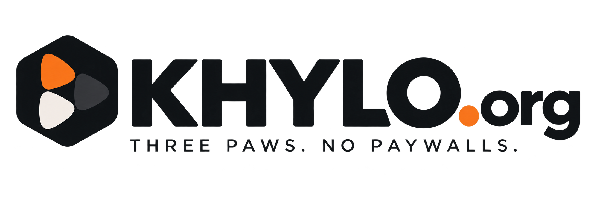

<p align="center">
  
</p>

<h1 align="center">Khylo for iPhone, iPad and Apple TV</h1>

<p align="center">
  Khylo for iPhone and iPad, with a calm, premium look built for touch. The Apple TV app is on the way.
</p>

---

## Highlights

- **Easy to get started.** Type your server's address (http or https) or let Khylo find it on your Wi-Fi, then sign in.
- **Home** with Continue Watching (cover, progress, time left, season and episode) and Up Next, kept in step with your other devices.
- **Libraries** with For You, Browse and Collections, and a search box in every library.
- **A video player** with subtitles and audio tracks that saves your place on the server.
- **Khylo TV:** join your always-on channels mid-show, with network logos. Pause and go back, but no skipping ahead of what's on air.
- **Live TV** with On Now, Channels and a guide, shown only when your server has a tuner or IPTV.
- **Music** with For You, artist mixes, every album on artist pages, a Now Playing screen that shows each song's quality, a mini player, the lock screen and AirPlay.
- **Audiobooks** with speed, sleep timer, back 15 / forward 30, and your place saved across devices.
- **Books:** EPUB, PDF and comics, with eight paper types, eight fonts, layout options and a real page curl.
- **Search** across everything, with All, Movies & TV, Music and Books, and categories made from your library's own genres.

## Khylo apps

| Part | Repository |
| --- | --- |
| Server | [Khylo-Server](https://github.com/mrkalodis/Khylo-Server) |
| Web app and dashboard | [Khylo-Web](https://github.com/mrkalodis/Khylo-Web) |
| Android TV and Google TV | [Khylo-AndroidTV](https://github.com/mrkalodis/Khylo-AndroidTV) |

## Building

**You need:** a Mac with Xcode 26 or newer. The app runs on iOS and iPadOS 18.6 or newer.

```bash
open Swiftfin.xcodeproj
```

Choose the **Swiftfin** scheme and an iPhone or iPad, then build and run. The first time, Xcode asks you to trust the project's Swift macros; allow them.

### Signing for your own device

To install on your own iPhone with a free Apple account, create `XcodeConfig/DevelopmentTeam.xcconfig` (it's ignored by git) with your team ID:

```
DEVELOPMENT_TEAM = YOUR_TEAM_ID
KHYLO_IOS_ENTITLEMENTS = Swiftfin/Resources/Swiftfin-PersonalTeam.entitlements
```

The second line uses entitlements that free (Personal Team) accounts allow.

### Build number

The version and build number come from the Khylo hub's release script, in the form `DEV-V<year>.<month>.<increment>` (for example `DEV-V26.10.019` becomes version `26.10.19`, build `2610019`). Don't change them by hand.

## License

Khylo is free software under the [Mozilla Public License 2.0](LICENSE.md). It is built on open-source components, including the Jellyfin project, whose copyright notices are kept in the source files as the license requires.
