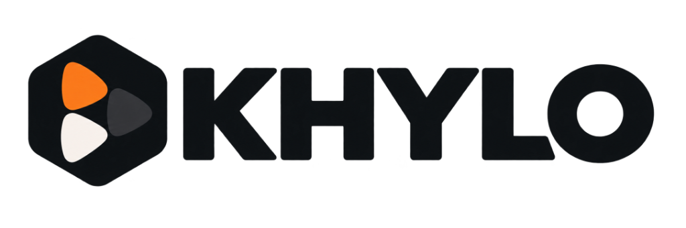

<div align="center">
  

  <p align="center">
    <b>The Next-Generation Native iOS Client for Khylo Media Ecosystem</b>
  </p>

  <p align="center">
    
    
    
    
    
  </p>
</div>

---

## 🌟 Overview

**Khylo for iOS** is a 100% native Apple client built to deliver complete feature parity with the Khylo Android TV ecosystem. Styled in our signature charcoal (`#08090A`) and warm amber accent (`#D97732`), it pairs high-fidelity media playback with a fluid, touch-optimized mobile experience designed specifically for iOS.

---

## 🚀 Key Features

### 🎬 Unified Video Player
- **Direct Playback Engine:** High-performance playback powered by native AVPlayer and VLCKit with hardware-accelerated HEVC, AV1, and VP9 decoding.
- **Intelligent Media Segments:** Auto-detects and offers one-tap skipping for Intros, Recaps, and Outros.
- **Gesture HUDs:** Vertical swipe controls for Brightness (left) and Volume (right); horizontal scrub with millisecond-precision feedback.
- **Up Next Countdown:** Non-intrusive 10-second end-credits transition card automatically queueing subsequent episodes.
- **Advanced Stream Selector:** Instant switching between audio tracks (Dolby Atmos, TrueHD, 5.1) and subtitle streams (SRT, PGS, VTT) with offset synchronization.

### 📺 Live TV & Multi-View
- **Multi-Stream Multi-View:** Watch up to **4 live streams simultaneously** with five distinct layout modes (Single, Split, Quad, 1+3 Focus PIP).
- **One-Tap Audio Focus:** Instant tap to redirect primary audio to any active stream.
- **24/7 Linear EPG:** Virtual linear channel guide with mid-program join and real-time progress indicators.

### 🎵 Lossless Music Player
- **Equalizer Visualization:** Real-time 5-band animated equalizer bars reflecting playback status.
- **Ambient Ken Burns:** Dynamic artist backdrop motion creating a living music experience.
- **Queue Management:** Interactive drag-to-reorder play queue with smart shuffle and repeat modes.

### 🎧 Warm Paper Audiobook Player
- **Parchment Theme:** Specially tuned warm paper interface designed for comfortable long listening sessions.
- **Dual Progress Metrics:** Real-time chapter progress and overall audiobook completion percentages.
- **Narration Controls:** Variable playback speeds ($0.5\times$ to $2.5\times$), sleep timers (15m, 30m, 45m, 60m, end of chapter), and 10s rewind / 30s skip.

### 📖 Integrated EPUB Reader
- **Paginated Reading Engine:** Fluid page flips with dynamic font scaling and margin adjustment.
- **Reading Themes:** Dedicated Sepia, Paper, and Night modes.
- **Interactive TOC:** Full chapter navigation drawer with reading progress bookmarks.

### 🛡️ Profiles & Family PIN Protection
- **Multi-Profile Switcher:** Instant account and profile switching with personalized Continue Watching, Next Up, and Recommendations.
- **Biometric Security:** PIN protection enhanced with **Face ID** and **Touch ID** authentication.
- **Kids Mode:** Dedicated curated environment restricting content strictly to G, PG, TV-Y, and TV-G ratings.

### 🥚 Klyrp Easter Egg
- Hidden interactive easter egg accessible via 7 rapid taps on the app build version in Settings.

---

## 📱 Architecture & Tech Stack

| Layer | Technology |
| :--- | :--- |
| **Language** | Swift 6.0 |
| **UI Framework** | SwiftUI + UIKit Interop |
| **Design Tokens** | Khylo Charcoal (`#08090A`), Khylo Amber (`#D97732`), Zinc Highlights |
| **Media Engine** | AVFoundation + VLCKit |
| **Authentication** | Direct Token Auth, QR Code Quick Connect, Face ID / Touch ID |
| **EPUB Engine** | Native ZIP & XML / XHTML Parsing |

---

## 📦 Building & Development

### Requirements
- **macOS:** macOS 14.0 (Sonoma) or newer
- **Xcode:** 15.4 or newer
- **iOS Target:** iOS 18.0+

### Setup
```bash
# Clone the repository
git clone https://github.com/mrkalodis/Khylo-iOS.git
cd Khylo-iOS

# Open in Xcode
open Swiftfin.xcodeproj
```

---

## 📄 License

Khylo iOS is licensed under the [Mozilla Public License 2.0 (MPL-2.0)](LICENSE).
